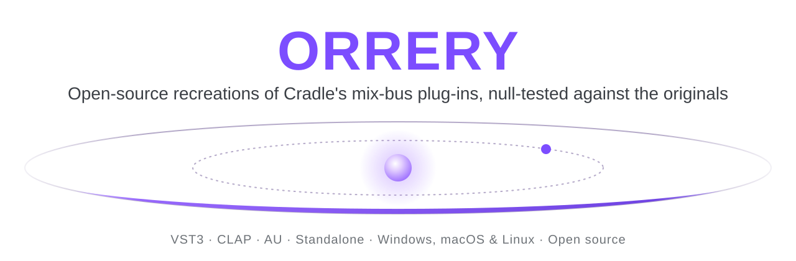
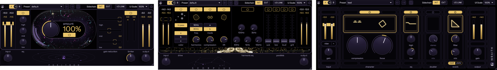

  <picture>
    <source media="(prefers-color-scheme: dark)" srcset="docs/branding/orrery-banner-dark.svg">
    
  </picture>

  
  
  
  
  

# Orrery Suite

Open-source recreations of Cradle's mixing plug-ins, null-tested against the originals. VST3, CLAP and AU for
Windows, macOS and Linux.

  

| Plug-in | Recreates | What it does |
|---|---|---|
| **[Positron](plugins/Positron)** | Cradle The God Particle | Mix-bus EQ, multiband "character" saturation and compression, look-ahead limiter |
| **[Scorpius](plugins/Scorpius)** | Cradle Orion | Drum-bus drive, harmonics, compression, lift, harmonic EQ and four parallel paths |
| **[Wraith](plugins/Wraith)** | Cradle The Spirit | Vocal chain: gain rider, compression with a focus EQ, two shelves, doubler, room and plate reverb |

> Orrery Suite is an independent project. It is not affiliated with, endorsed by or sponsored by Cradle, Jaycen
> Joshua or Louis Bell. Product names are theirs and only describe what each plug-in is modelled on. No code, models or
> data of theirs is included; Wraith's two reverb responses are measured from The Spirit's output, as its
> MEASUREMENTS.md describes.

## How it was built

Orrery Suite is made with Claude (Anthropic's AI): the code, the measurements behind it and this documentation. The
originals are the reference for every behaviour, as [Positron's](plugins/Positron/MEASUREMENTS.md),
[Scorpius's](plugins/Scorpius/MEASUREMENTS.md) and [Wraith's](plugins/Wraith/MEASUREMENTS.md) measurements describe.

## Features

- **Null-tested sound.** Each plug-in is measured against its original with the same audio, and every result is
  published, good or bad ([How close](#how-close)).
- **The originals' controls and editors**: same layout, knobs, meters, factory presets and visualisers, measured from
  the originals.
- **A few additions**, in the same top bar on every plug-in: A / B compare, an external side-chain (INT / EXT) and
  **I/O LINK**, which turns the output down as you turn the input up so you can drive harder at the same level.

  

- **Particle visualisers that follow your music**, in each original's style or ours, moving with the project's tempo.

  

- **Resizable** from 50 to 200 %. Oversampling up to 8x in Positron.

## Quick start

1. Download the installer for your system from the [latest release](https://github.com/MaymiPR/Orrery/releases/latest).
   One installer holds every plug-in:

   | System | File | Installs |
   |---|---|---|
   | Windows | `OrrerySuite-<version>-Windows-Setup.exe` | VST3 and CLAP to `C:\Program Files\Common Files\`, standalone apps if you choose, with an uninstaller |
   | macOS 10.13+ (universal) | `OrrerySuite-<version>-macOS.pkg` | AU, VST3 and CLAP (you choose which), and the standalone apps if you tick them |
   | Linux x86-64 (glibc 2.35+) | `OrrerySuite-<version>-Linux.tar.gz` | VST3 and CLAP: run `sh install-linux.sh` to copy them to `~/.vst3` and `~/.clap` |

2. Run it, then rescan plug-ins in your DAW.

The release notes say whether a download is signed. An unsigned installer shows a warning the first time:

- **Windows SmartScreen:** *More info*, then *Run anyway*.
- **macOS 15 and later:** open it once, then System Settings > Privacy & Security > *Open Anyway*. Earlier macOS:
  right-click, then *Open*.

Each release lists SHA-256 checksums in `SHA256SUMS.txt`, and its files carry GitHub build provenance attestations
(`gh attestation verify <file> --repo MaymiPR/Orrery`), so a download can be checked.

## Usage

The plug-ins work the same way:

- **Knobs:** drag up or down. Shift drags finely, Alt-click resets, double-click types a value.
- **Presets:** pick one from the menu or step with the arrows; the disk button saves your own.
- **A / B:** click A or B to switch between two complete settings; the arrow copies the active one over the other.
- **Settings** (gear, Positron and Scorpius): particle animation on or off and its style. Positron also has oversampling and the
  meter mode (RMS or LUFS).

Each plug-in's page covers its controls in detail: [Positron](plugins/Positron#using-it),
[Scorpius](plugins/Scorpius#using-it), [Wraith](plugins/Wraith#using-it).

## How close

The residual is the difference between the original's output and ours, in dB below the original's level. Lower is
better: -60 dB is inaudible in practice.

| | Positron | Scorpius | Wraith |
|---|---|---|---|
| Mastered track, default settings | -49.6 dB | -25.8 dB | not tested (a vocal chain) |
| Synthetic music / drums, default settings | -62 to -74 dB | -29.7 dB (drums) | -23.6 dB (music), -21.0 dB (drums) |
| Best parts | EQ, crossover, signal path: -79 to -87 dB | EQ, sub, rate converters: -50 to -70 dB | gains, EQ, gain rider, reverb: -63 to -143 dB |
| Weakest part | the character section on loud, dense material (-44 to -48 dB) | the drive on loud, dense material (the reason for the default's -24 to -28 dB) | the character section (a fitted model, -15 to -29 dB) and the doubler fully wet (-11 to -27 dB) |

Every case is listed in each plug-in's NULLTESTS.md ([Positron](plugins/Positron/NULLTESTS.md),
[Scorpius](plugins/Scorpius/NULLTESTS.md), [Wraith](plugins/Wraith/NULLTESTS.md)), and how the originals were measured in its MEASUREMENTS.md.

## Building from source

CMake 3.22 or later, Git and a C++17 compiler; CMake fetches JUCE. The commands per platform, the Linux packages and
the Windows installer are in the [build guide](docs/BUILDING.md).

## Contributing

Found a bug or a difference from the original? Open an
[issue](https://github.com/MaymiPR/Orrery/issues/new/choose) and attach the settings or a preset that shows it.
To change the code, read [CONTRIBUTING.md](CONTRIBUTING.md) for the tests, the null tests against the originals and
the release steps. Changes per version are in [CHANGELOG.md](CHANGELOG.md).

## Security

A file that makes a plug-in crash or misbehave is a security bug. Please report it privately, as described in
[SECURITY.md](SECURITY.md), not in a public issue.

## License

Orrery Suite is open source under the [GNU Affero General Public License v3](LICENSE). It is built with
[JUCE](https://juce.com) (used under the AGPLv3), the VST3 SDK, CLAP and clap-juce-extensions (MIT), and uses the
Instrument Sans font (SIL Open Font License 1.1). Their licenses are in
[THIRD-PARTY-NOTICES.txt](packaging/THIRD-PARTY-NOTICES.txt) and ship with every download.

Cradle, The God Particle, Orion and The Spirit are names of their owners and are used only to describe what each plug-in is
modelled on.
