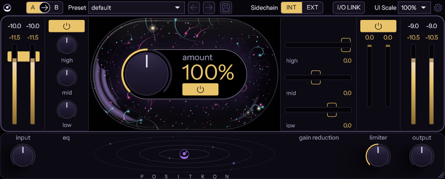
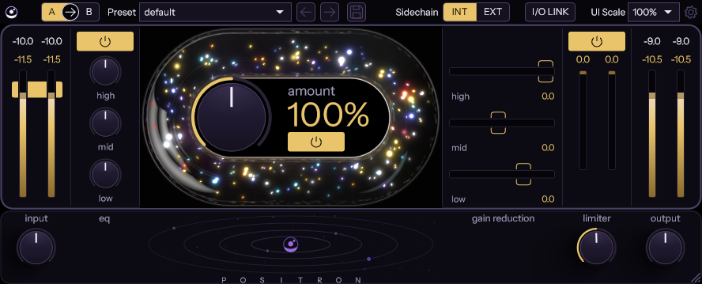

# Positron

Part of [Orrery Suite](../../README.md). A recreation of Cradle's The God Particle (v1.2.4): its controls, layout and
sound, null-tested against the original, drawn in Orrery Suite's own look.

  
  

- [RESEARCH.md](RESEARCH.md): what the original does, and the editor's measurements.
- [MEASUREMENTS.md](MEASUREMENTS.md): how its audio behaves, measured from its output.
- [NULLTESTS.md](NULLTESTS.md): how closely Positron matches it, in dB of residual.

## What it does

Input gain feeds the stages below; output gain comes last.

| Stage | What it is |
|---|---|
| EQ | Three RBJ filters: low shelf 180 Hz, bell 637 Hz, high shelf 10 kHz, ±6 dB each. |
| Character, amount 0 to 200 % | A 3-band split by a linear-phase FIR crossover (157 Hz / 2.68 kHz). Each band runs a stereo-linked parallel compressor that listens to the mid signal, then a sine shaper (odd harmonics); the side is widened per band. |
| Limiter | Look-ahead, a -0.1 dBFS sample-peak ceiling and a two-speed release; input gain 0 to 12 dB. |

Each stage has its own power button. Oversampling (1 / 2 / 4 / 8x) and the I/O meter mode (RMS or LUFS readouts) are
global settings (gear icon); as in the original, 8x sounds like 4x. INT / EXT picks the character section's detector
input: the main signal or the side-chain bus.

## Using it

- **Knobs:** drag up or down. Shift for fine adjustment; Alt-click resets; double-click to type a value. While the
  mouse is over a knob, its label shows the value.
- **I/O LINK** (top bar, ours): the output gain follows the input gain inverted, so the chain can be driven harder
  without the level changing.
- **A / B** (top bar, left of the preset menu, ours): two complete settings in one instance. Click A or B to switch;
  a setting not used yet starts as a copy of the other. The arrow copies the active setting over the other ("A
  copied to B."). Both are saved with the host's project.
- **Presets:** the arrows step through them; the save button stores the EQ, character and limiter settings as a
  `.positron` file in `Documents/Positron/Presets`. Input, output and INT / EXT are left as they are.
- **Settings** (gear): oversampling, meter mode, particle animation on or off, and its style: "Classic" (sparks after
  the original's) or "Positron" (ours, the default: bubble-chamber pair creation and annihilation). The particles
  follow the input level and fade with quiet passages.
- **Zoom:** 50 to 200 % from the box next to the gear, or drag the bottom-right corner to any size in between (the
  proportions stay). The logo opens the version and About.

## How close

The fixed path, the EQ and the crossover null at -79 to -87 dB; the character section nulls music at -70 to -75 dB
from 12.5 to 187.5 %; the limiter -78 dB on music and drums and -55 dB under continuous heavy limiting of pink noise.
On program material the full chain lands at -57 to -75 dB; the stress tests (163 cases over settings, levels,
signals, automation, rates and block sizes) have a median of -66.0 dB and a worst case of -44.1 dB. The built VST3
and the offline renderer give the same numbers. Every case: [NULLTESTS.md](NULLTESTS.md).

## Tests

- `tests/PositronTests.cpp`: unit tests of the DSP and the processor, including filters, the FIR crossover, latency,
  bypass, the limiter's ceiling, state and extreme input (`ctest` after a build).
- `nulltest/`: the null tests against an installed copy of the original (Windows, Python 3.12 or newer with the root
  `requirements.txt`; not in CI). `nulltest.py` (the table in NULLTESTS.md), `null_stress.py` (163 cases) and `null_track.py`
  (a music file of your own) are the entry points; `tgp.py` is the render harness. The other scripts are the
  measurements and fits that MEASUREMENTS.md cites. Reference renders and measurement data stay local (git-ignored).
- `tools/`: PoRender (our processor offline, every DSP constant open to change), the editor snapshot, the band gain
  computer as a C library for the fits, and the measuring tools for the knobs and the glass (their numbers become the
  drawing's tokens; `make_glass.py` draws the glass textures).
