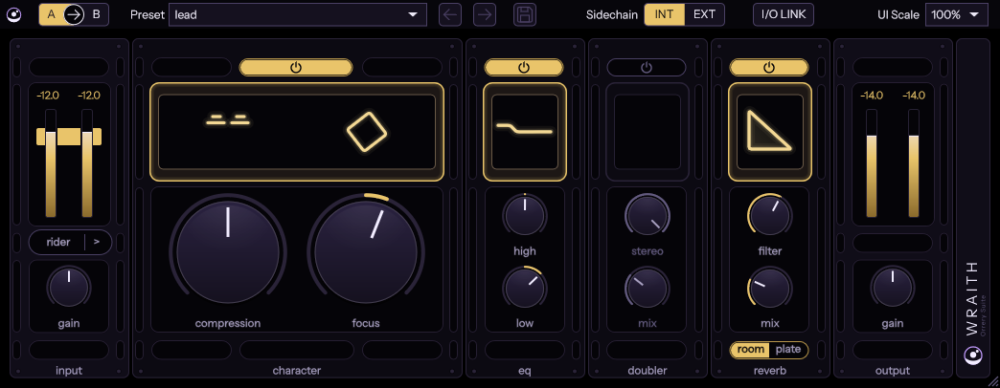

# Wraith

Part of [Orrery Suite](../../README.md). A recreation of Cradle's The Spirit (v1.0.3), the vocal chain made with
producer Louis Bell: its controls, look and sound, null-tested against the original. Named for the spirit's other,
quieter kind.

  

- [RESEARCH.md](RESEARCH.md): what the original does, its controls and presets.
- [MEASUREMENTS.md](MEASUREMENTS.md): how its audio behaves, measured from its output.
- [NULLTESTS.md](NULLTESTS.md): how closely Wraith matches it, in dB of residual.

## What it does

The stages run in this order, each with its own power button: input gain, rider, character, eq, reverb, doubler,
output gain. Zero latency, like the original.

| Stage | What it is |
|---|---|
| Rider | Automatic gain riding toward a fixed target: up to 20 dB of boost, with the cut and boost scaled by Amount, Speed as its attack, and below the Floor the boost fading out so background noise is left alone. |
| Character | Compression and the vocal EQ in one: Focus scales a set of EQ curves (-50 to +50); Compression drives a compressor that holds the output near a fixed ceiling, with a gentle expander under it. |
| EQ | A low shelf at 200 Hz and a high shelf at 5 kHz, -12 to +12 dB. |
| Reverb | The original's room or plate (measured from its output), a high-cut filter on the reverb and a dry / wet Mix. |
| Doubler | Two voices delayed 6 to 9 ms and moving against each other at about 0.5 Hz; Stereo spreads them, Mix sets how much. |

## Using it

- **Knobs:** drag up or down (250 px for the whole range). Shift drags finely; double-click or Alt-click resets the
  knob to its default, as the original does.
- **Rider:** the rider button turns it on; the ">" beside it opens Speed, Amount and Floor. The Floor shows as a red
  line on the input meter while you turn it.
- **Power buttons** above character, eq, doubler and reverb switch each stage; a stage that is off goes dark.
- **room / plate** under the reverb picks the response; hosts see it as the Reverb Type parameter (the original keeps
  it in its preset only).
- **Presets:** the original's eleven factory presets at their exact values ("lead" is the one it opens with);
  the save button stores your own as a `.wraith` file in `Documents/Wraith/Presets`.
- **Compare A -> B** (top bar, ours): two complete settings in one instance; the arrow copies the active one over the
  other.
- **Sidechain INT / EXT** (ours): EXT has the character section's compressor and expander listen to the side-chain
  bus instead of the vocal (the rider keeps riding the vocal). With no side-chain connected in the host it stays on
  the vocal.
- **I/O LINK** (ours): the output gain follows the input gain inverted, so the chain can be driven harder without the
  level changing.
- **Zoom:** 50 to 200 % from the UI Scale box or the corner.

## How close

The gains, EQ, rider and reverb are the original's own laws and responses: they null at -63 to -143 dB. The
character section is a fitted model of the original's expander, drive and compressor, its overshoot after a rise in
level and its measured static curve included (about -16 to -29 dB on steady and program material, -15 to -25 dB on
drums), and it sets the level of the whole chain's null: -24 dB on music and -21 dB on drums at the start-up preset.
The doubler is a model too: -25 to -39 dB at Mix 0.1 and -11 to -27 dB fully wet, its level within 0.1 dB of the
original's, its modulation at the original's measured rate (about 0.503 Hz).
Every case: [NULLTESTS.md](NULLTESTS.md).

## Tests

- `tests/WraithTests.cpp`: unit tests of the processor, the parameters and their tapers, the presets and the state
  (`ctest` after a build).
- `nulltest/`: the null tests against an installed copy of the original (Windows, Python 3.12 or newer with the root
  `requirements.txt`; not in CI). `nulltest.py` runs every case and writes NULLTESTS.md, `first_null.py` checks the
  hosts and our VST3 against our renderer, `ts.py` is the render harness. The `probe_*.py` and `fit_*.py` scripts are
  the measurements and fits that MEASUREMENTS.md cites; `plate_record.py` and `pack_reverb.py` make the reverb
  responses in `ir/`. Reference renders, captures and measurement data stay local (git-ignored).
- `tools/`: WrRender (our processor offline, every DSP constant open to change) and the editor snapshot.
